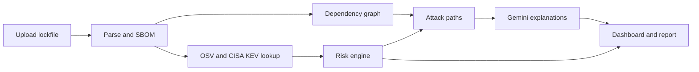

# SupplyGuard

[](https://github.com/aaishadhungana/supplyguard/actions/workflows/ci.yml)

SupplyGuard scans a project's dependencies for known vulnerabilities and ranks them by how much they matter to that specific application. You upload a `package-lock.json` or a pinned `requirements.txt`, and it tells you which findings to fix first and why. I built it as a portfolio project.

## What it does

- Parses the file into a dependency inventory and graph (direct or transitive, production or development) and exports a CycloneDX SBOM.
- Looks up each package version on [OSV.dev](https://osv.dev) and checks the CVEs against CISA's Known Exploited Vulnerabilities list.
- Scores every finding from 0 to 100 with a fixed formula. The inputs are CVSS, known exploitation, internet exposure, app criticality, package role and dependency chain. The formula is in [docs/risk-model.md](docs/risk-model.md).
- Finds the shortest dependency chain from the application to each vulnerable package.
- Sends the top findings to Gemini for plain-language explanations and fix suggestions. Gemini never decides what is vulnerable and cannot change a score. If the key is missing or the API fails, scans still complete without the AI text.
- Shows everything in a dashboard, downloads a Markdown report, and compares two scans to show what a fix changed.



## Run it locally

You need Docker Desktop.

1. Clone the repo and create a file named `.env` in the project root:

```env
   POSTGRES_USER=supplyguard
   POSTGRES_PASSWORD=choose-a-password
   POSTGRES_DB=supplyguard
   POSTGRES_HOST=db
   JWT_SECRET_KEY=<at least 32 random characters>
   GEMINI_API_KEY=
   GEMINI_MODEL=
```

   Generate the secret with `python -c "import secrets; print(secrets.token_urlsafe(48))"`. `GEMINI_API_KEY` is optional; get a free one from Google AI Studio. Never commit this file.

2. Start the stack and create the tables:

```bash
   docker compose up --build -d
   docker compose exec backend alembic upgrade head
```

3. Open http://localhost:3000, create an account, add a project and upload a lockfile. API docs are at http://localhost:8000/docs.

## Demo

`fixtures/` has two intentionally vulnerable projects built from old, real package versions, plus a remediated one for before and after comparisons. For npm, generate the lockfile without installing anything:

```bash
cd fixtures/npm-vulnerable && npm install --package-lock-only --ignore-scripts
```

[docs/demo.md](docs/demo.md) has the full walkthrough.

## Tests

```bash
docker compose exec backend pytest -q
```

Tests run against a separate `supplyguard_test` database, with OSV and Gemini replaced by fakes. CI runs them on every push, builds the frontend and audits dependencies.

## Production build

`docker-compose.prod.yml` builds the production images. Set `ENVIRONMENT=production`, a real database password, `CORS_ORIGINS` and `PUBLIC_API_URL` in `.env` first. Security controls and known gaps are in [docs/security.md](docs/security.md).

## Limitations

- Attack paths are dependency chains read from the lockfile. I don't check whether the vulnerable code is actually called.
- npm needs lockfile version 2 or 3. Python scans cover pinned direct requirements only.
- No outdated-version check and no EPSS score yet.
- Rate limits are in memory, so they reset on restart.

Built with FastAPI, PostgreSQL, SQLAlchemy, Alembic, Next.js, TypeScript, Tailwind and Docker.